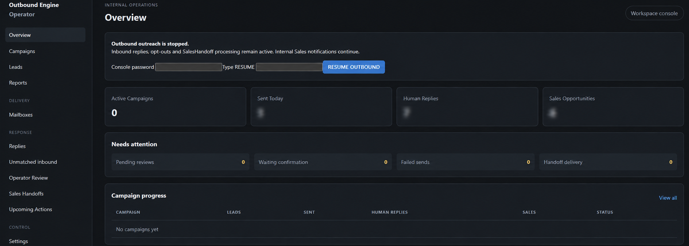
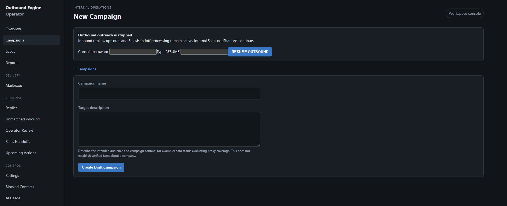
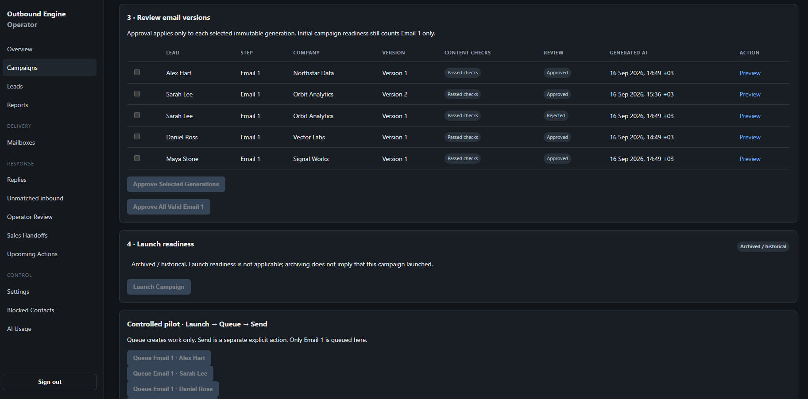
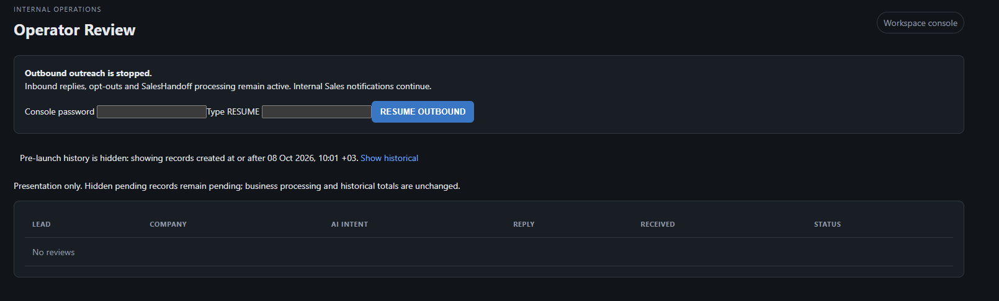
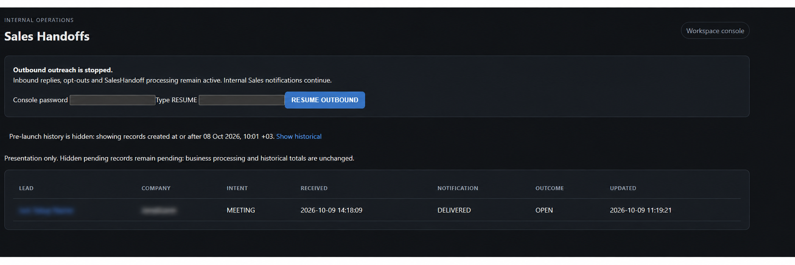
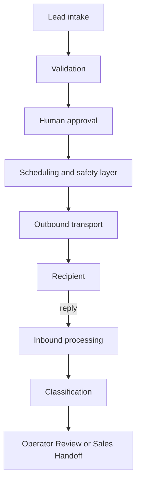

# Outbound Engine

A human-supervised B2B email outreach system: it schedules multi-step campaigns across several mailboxes, processes replies, and keeps AI and automation inside strict safety boundaries.

Built with Python, FastAPI, SQLAlchemy/SQLite, SMTP/IMAP and OpenAI. This repository is a curated portfolio view of a private system, not a runnable product.



*Private operational metrics are redacted.*

## The problem

Outreach automation can do real damage when it acts on its own: duplicate sends, mail to people who opted out, or an AI model deciding what gets sent. This project explores how to build outbound automation that stays fast but remains subject to human judgment, capacity limits and explicit safety boundaries.

## What the system does

- Imports leads and runs multi-step campaigns across multiple mailboxes
- Generates email drafts with AI, then requires a human to approve the exact content before anything is sent
- Schedules sends deterministically within per-mailbox capacity limits
- Polls inbound mail, correlates replies, and classifies them (deterministic rules first, AI second)
- Routes positive replies to a Sales Handoff queue and ambiguous ones to Operator Review
- Honors opt-outs and suppression automatically, with a global emergency stop

## My role

I designed the product and its architecture, defined the safety boundaries and acceptance criteria, and decided how AI, automation and human review divide the work. The implementation was done with AI coding assistants (design discussions with ChatGPT, implementation with Codex) under my direction, then checked with automated tests, end-to-end runs and reviews.

This repository shows how I think about system design and reliability. I do not present it as hand-written code.

## Screenshots

### Campaign Setup


### Human Approval


### Operator Review


### Sales Handoff


*Sensitive lead and company identifiers are redacted.*

## Key design decisions

- **AI never authorizes an external action.** Models draft text and suggest labels. Sending, routing, suppression and scheduling are decided by deterministic code, and a person approves the exact email version before it can be sent.
- **Uncertain outcomes fail closed.** If it is unclear whether a message was delivered, the system does not retry blindly. It records the uncertainty and waits for evidence or an operator.
- **Transport success is not delivery.** SMTP acceptance, Sent-folder synchronization and recipient receipt are tracked as separate facts. A synchronization failure can never trigger a second send.
- **Capacity and suppression are hard limits.** Per-mailbox ceilings, cooldowns and opt-out lists constrain automation regardless of what an AI model suggests.
- **Provider-independent interfaces.** SMTP/IMAP sit behind abstractions with fake adapters, so behavior can be tested offline without real mailboxes.
- **An emergency stop that does not depend on providers.** A global stop disables outbound sending on its own authority.

More in [security and safety](docs/security-and-safety.md) and [engineering notes](docs/engineering-notes.md).

## Architecture

The diagram describes responsibilities, not implementation order or internal data structures.



See [architecture](docs/architecture.md) for a short, non-operational description.

## Technology

**Private system:** Python, FastAPI, SQLAlchemy, SQLite, OpenAI, SMTP/IMAP, pytest, mypy, Ruff, Bandit, Ubuntu, systemd.

**Public examples:** Python standard library only. Development checks use pytest, mypy, Ruff and Bandit.

## Selected code examples

Small, newly written examples that illustrate design principles. They are not copies of the private implementation.

| Example | What it demonstrates | What it deliberately does not implement |
| --- | --- | --- |
| [Approval gate](src/portfolio_examples/approval_gate.py) | Immutable review snapshots and deny-by-default checks | Reviewer authentication, persistence, or final-send authorization |
| [Capacity guard](src/portfolio_examples/capacity_guard.py) | Validated counters and equality/zero-limit boundaries | Selection, scheduling, allocation, or reservations |
| [Transport protocols](src/portfolio_examples/transport_protocols.py) | Typed interfaces and an in-memory fake | SMTP, IMAP, MIME, provider access, or delivery |
| [Lifecycle types](src/portfolio_examples/lifecycle_types.py) | Enums and frozen dataclasses | Database models or a transition/recovery system |
| [Routing example](src/portfolio_examples/routing_example.py) | Three illustrative destinations and missing-evidence review | AI classification, production rules, or workflow side effects |

A successful approval or capacity check here does not authorize any external action, and the fake receipt only means an object was recorded in memory.

## Testing

The private codebase has been validated with **more than 1,500 offline automated tests** covering sending, scheduling, inbound processing, safety gates, recovery paths and operator workflows. This is historical private validation: that suite is not part of this repository and was not rerun for it.

The public examples have their own checks. For local evaluation with Python 3.11 or newer:

```sh
python -m venv .venv
# Activate the environment using your operating system's normal command.
python -m pip install -e ".[dev]"
python -m pytest -q
python -m mypy src
python -m ruff check src tests
python -m bandit -r src -q
```

Result for the public examples: **38 tests pass**, strict mypy passes on all 10 Python files, Ruff passes, and Bandit passes on the six example modules. Tests ran offline with socket operations blocked and external pytest plugins disabled. No private module was imported.

## Controlled end-to-end validation

The private system has been validated end to end with real test mailboxes and controlled recipients (not a live customer campaign):

- Automated first-touch scheduling and sending
- Inbound reply polling and correlation
- Positive-reply routing to Sales Handoff
- Emergency-stop behavior
- Sent-folder synchronization after successful SMTP delivery

Operational identifiers, recipients, infrastructure details and customer data are intentionally omitted.

## What this repository is and is not

This is a **curated portfolio representation of a private system**, not an open-source distribution. The included code consists of isolated examples and **does not constitute a runnable outbound platform**. There is no console startup, campaign import, real send, mailbox polling, deployment, or "just add credentials" path.

Not included: production source, orchestration, scheduling and selection algorithms, recovery algorithms, provider integrations, classification prompts, customer logic, database schema and migrations, deployment configuration, operational scripts, credentials, or campaign data.

Design goals described here are tested boundaries of the private system, not guarantees provided by the standalone examples. SMTP acceptance is not proof of delivery, and external systems offer no end-to-end exactly-once guarantee.

## Usage notice

Copyright © 2026 B2Bound. All rights reserved.

No open-source license is granted.

This repository is provided solely for portfolio and evaluation purposes. No permission is granted to copy, modify, redistribute, sublicense, or commercially use the source code or documentation.
