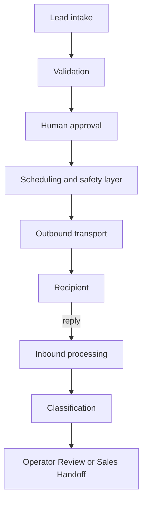

# Outbound Engine

Outbound Engine is a production-oriented Python application built to orchestrate
multi-step B2B email outreach across multiple mailboxes, with deterministic
scheduling, human approval gates, capacity controls, inbound reply processing,
AI-assisted classification, and fail-closed delivery safeguards.

## Highlights

- Multi-mailbox outbound orchestration with deterministic safety controls
- Human approval and emergency-stop boundaries
- Automated inbound reply processing with AI-assisted classification
- Production validation backed by more than 1,500 offline automated tests

## Portfolio Notice

This repository is a **curated portfolio representation of a private production
system**, not an open-source distribution.

It intentionally omits proprietary orchestration, recovery algorithms, provider
integrations, deployment configuration, customer-specific logic, and operational
infrastructure.

The included source files are isolated examples intended to demonstrate
engineering patterns and code quality. **They do not constitute a runnable
outbound platform.** The included examples are intentionally non-operational and
omit the components required to run a complete outbound platform.

## Overview

The private system addresses a coordination problem: outreach automation must
remain subject to human judgment, capacity limits, and explicit safety boundaries.
It brings outbound workflows and inbound attention into a private operator
interface, without treating AI output or transport acceptance as unquestionable
business evidence.

This portfolio explains that work at a high level and supplies small, newly
written educational examples. It does not distribute a partially assembled
version of the product.

## Engineering Scope

The private project's engineering scope includes:

- Python backend development and a FastAPI operator console.
- SQLAlchemy/SQLite persistence and deterministic scheduling.
- Multi-mailbox capacity management and approval-gated message lifecycles.
- SMTP/IMAP abstraction and automatic Sent-folder synchronization.
- Inbound reply polling and AI-assisted classification.
- Operator Review, Sales Handoff, and suppression/opt-out handling.
- Fail-closed recovery and Ubuntu/systemd deployment.

These capabilities describe the private project. Their implementations are
intentionally absent from this repository.

## Architecture

The diagram describes responsibilities, not implementation ordering or internal
data structures.



See [architecture](docs/architecture.md) for a short, non-operational description.
No component shown here is assembled into a working platform in the public code.

## Safety & Reliability

Private-system safety principles include:

- Global emergency stop and explicit human approval.
- Mailbox/provider capacity ceilings, suppression, and cooldown checks.
- Idempotent send protection and fail-closed handling of uncertain outcomes.
- No blind retry after uncertain delivery.
- Operator review for ambiguous events.
- Sent synchronization failure cannot trigger a duplicate SMTP send.

These are design goals and tested private-system boundaries, not guarantees
provided by the standalone examples. SMTP acceptance is not proof of recipient
delivery, and external systems do not provide an end-to-end exactly-once promise.

The [security and safety notes](docs/security-and-safety.md) intentionally omit
recovery transitions, allocation algorithms, and operational procedures.

## AI Usage

AI is used selectively in the private system for tasks such as reply
classification and bounded messaging assistance. Critical delivery and safety
decisions remain deterministic and human-controlled where appropriate.

The public routing example consumes a supplied label. It does not classify text,
contain a prompt, call a model, or reproduce the private business decision tree.
No AI credentials or provider adapters are included.

## Technology Stack

Private project: Python, FastAPI, SQLAlchemy, SQLite, pytest, mypy, Ruff, Bandit,
SMTP/IMAP, Ubuntu, and systemd.

Public examples: Python standard library only. Development checks use pytest,
mypy, Ruff, and Bandit. There is no FastAPI dependency, database driver wiring,
network client, or service entrypoint in the examples.

## Selected Code Examples

| Example | What it demonstrates | What it deliberately does not implement |
| --- | --- | --- |
| [Approval gate](src/portfolio_examples/approval_gate.py) | Immutable review snapshots and deny-by-default checks | Reviewer authentication, persistence, or final-send authorization |
| [Capacity guard](src/portfolio_examples/capacity_guard.py) | Validated counters and equality/zero-limit boundaries | Selection, scheduling, allocation, or reservations |
| [Transport protocols](src/portfolio_examples/transport_protocols.py) | Typed interfaces and an in-memory fake | SMTP, IMAP, MIME, provider access, or delivery |
| [Lifecycle types](src/portfolio_examples/lifecycle_types.py) | Enums and frozen dataclasses | Database models or a transition/recovery system |
| [Routing example](src/portfolio_examples/routing_example.py) | Three illustrative destinations and missing-evidence review | AI classification, production rules, or workflow side effects |

These independent examples illustrate design principles, not renamed copies of
production algorithms. A successful approval/capacity check does not authorize
an external action. A fake receipt means only that an object was recorded locally.

## Testing

The private production codebase has been validated with **more than 1,500 offline
automated tests** covering sending, scheduling, inbound processing, safety gates,
recovery paths, and operator workflows. That is historical private validation;
this repository does not contain that suite, and it was not rerun for this task.

The public example suite is reported separately below. It exercises only the
small, fictional examples and never accesses production state.

For local evaluation with Python 3.11 or newer:

```sh
python -m venv .venv
# Activate the environment using your operating system's normal command.
python -m pip install -e ".[dev]"
python -m pytest -q
python -m mypy src
python -m ruff check src tests
python -m bandit -r src -q
```

Dependency installation may require a package index or cached wheels. The
examples and tests themselves do not perform network operations. They need no
environment configuration, account, database, or provider credential.

Public example validation: **38 tests PASS**, strict mypy PASS on all 10 Python
files, Ruff PASS, and Bandit PASS on the six example modules. Tests were run
offline with socket operations blocked and external pytest plugins disabled.
No private application module was imported. These results are separate from the
private system's historical test count.

## Screenshots

### Operator Console


Private operational metrics are redacted.

### Campaign Setup


### Human Approval


### Operator Review


### Sales Handoff


Sensitive lead and company identifiers are redacted.

## Production Validation Highlights

The private system has completed controlled production validation for:

- Automated first-touch scheduling and sending.
- Inbound reply polling and correlation.
- Positive-reply routing to Sales Handoff.
- Emergency-stop behavior.
- Sent-folder synchronization after successful SMTP delivery.

Operational identifiers, recipients, infrastructure details, and customer data
are intentionally omitted.

## Engineering Lessons

- Keep deterministic safety boundaries around automation.
- Separate transport success, mailbox synchronization, and recipient delivery.
- Treat uncertain outcomes as decisions requiring evidence, not permission to retry.
- Design human-in-the-loop workflows without turning approval into a UI-only rule.
- Use provider-independent interfaces and fake adapters to test boundaries.
- Use observability and acceptance tests to distinguish intent from real behavior.

See [engineering notes](docs/engineering-notes.md) for the concise lessons.

## Repository Scope

Not included: complete production source, orchestration, scheduler or selection
algorithms, recovery algorithms, provider integrations, classification prompts,
customer logic, production database/schema/migrations, deployment configuration,
operational scripts, credentials, or campaign data.

There is no console startup, campaign import, real send, mailbox polling,
deployment, or "just add credentials" path. The previous comprehensive candidate
and its history are not part of this repository.

Suggested repository metadata is in [GitHub profile](docs/github-profile.md).
Publication remains subject to owner review; no remote is configured.

## Usage Notice

Copyright © 2026 B2Bound. All rights reserved.

No open-source license is granted.

This repository is provided solely for portfolio and evaluation purposes. No
permission is granted to copy, modify, redistribute, sublicense, or commercially
use the source code or documentation.
